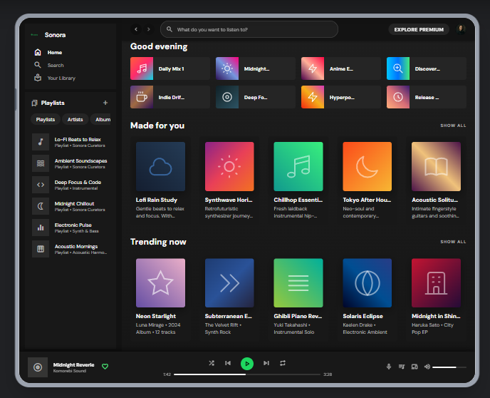
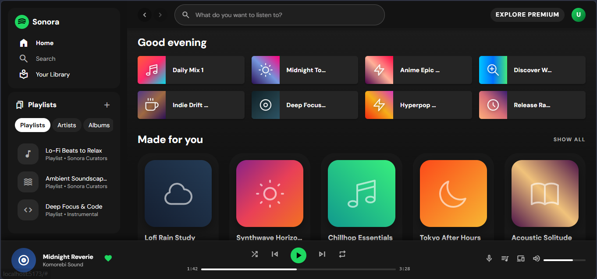

# Design Like a Giant, Build Like a Pro
### AI-Powered Rapid App Development with Google Stitch & Antigravity

[](https://devfest.withgoogle.com)
[](#)
[](LICENSE)

Repository ini berisi kode demo, aset, dan panduan workflow untuk sesi talk & workshop **Cloud DevFest Surabaya '26**.

> **TL;DR** — Ambil design system brand ternama → minta Claude menyusun prompt UI → generate layout di Google Stitch → hubungkan Stitch ke Antigravity lewat MCP → minta agent mengubah desain menjadi kode.

---

## 📌 Abstract

Sering kali hambatan dalam membangun aplikasi bukan pada logika kode, melainkan pada merancang UI/UX yang konsisten dan berstandar tinggi. Bagaimana jika kita bisa mengadopsi standar desain brand kelas dunia, menjadikannya referensi, lalu menerjemahkannya langsung menjadi kode aplikasi yang siap pakai?

Sesi ini membahas workflow modern untuk membangun aplikasi mobile dan web tanpa harus mendesain semuanya dari nol. Kita memanfaatkan platform referensi desain, mengimplementasikan desain dengan presisi lewat **Google Stitch**, dan mempercepat development secara drastis dengan **Antigravity**.

---

## 🗺️ Alur Kerja (Overview)

```
getdesign.md → Claude (UI Prompt) → Google Stitch → Stitch API Key → Antigravity + MCP → Kode UI
   (design.md)    (prompt per layar)   (layout desain)   (autentikasi)    (fetch desain)    (siap pakai)
```

| # | Tahap | Tool | Output |
|---|-------|------|--------|
| 1 | Ambil design kit | getdesign.md | `design.md` |
| 2 | Susun prompt UI | Claude | Prompt per layar |
| 3 | Generate desain | Google Stitch | Project + halaman desain |
| 4 | Siapkan koneksi | Stitch Settings + Antigravity | API Key + MCP aktif |
| 5 | Implementasi kode | Antigravity | Komponen UI |

---

## 🧰 Prasyarat

- Akun Google (untuk Google Stitch & Antigravity)
- Akses ke [Claude](https://claude.ai)
- **Google Antigravity** sudah terinstal
- Koneksi internet stabil
- Pengetahuan dasar framework target (React / Flutter / dll.)

---

## 🚀 Langkah Detail

### Tahap 1 — Ambil Design Kit dari getdesign.md

1. Buka [www.getdesign.md](https://www.getdesign.md).
2. Pilih brand/platform yang ingin dijadikan referensi gaya (contoh: Linear, Vercel, Stripe).
3. Unduh atau salin file **`design.md`** milik brand tersebut.
4. Simpan di folder project, misalnya `docs/design.md`.

> 💡 **Tips:** Pilih satu brand saja per project agar hasilnya konsisten.

---

### Tahap 2 — Buat Prompt UI dengan Claude

1. Buka Claude dan lampirkan (atau paste) isi `design.md`.
2. Jelaskan aplikasi yang ingin dibuat: tujuan, target pengguna, dan daftar layar.
3. Minta Claude menyusun **prompt UI terstruktur untuk tiap layar**.

**Contoh prompt ke Claude:**

> *"Berikut design system dari [nama brand]: [isi design.md]. Saya ingin membuat aplikasi [deskripsi singkat]. Buatkan prompt UI yang detail untuk layar: Login, Home, dan Detail. Sertakan layout, komponen, hierarki visual, warna, tipografi, dan state yang relevan, sesuai design system di atas."*

4. Simpan hasilnya (misalnya `prompts/ui-prompts.md`) agar mudah dipakai ulang.

---

### Tahap 3 — Generate Desain di Google Stitch

1. Buka **Google Stitch** dan buat project baru.
2. Masukkan **dua input sekaligus**:
   - isi `design.md` (acuan gaya visual), dan
   - prompt UI dari Claude (acuan struktur layar).
3. Jalankan generate dan tunggu hingga layout selesai.
4. Review hasilnya, lalu revisi dengan prompt lanjutan bila perlu.

> ⏳ **Sambil menunggu proses generate**, lanjutkan ke Tahap 4 supaya waktu terpakai efisien.

---

### Tahap 4 — Hubungkan Google Stitch dengan Antigravity (via MCP)

**4a. Ambil API Key**
1. Buka **Settings** di Google Stitch.
2. Pilih menu **Get API Key**, lalu buat dan salin key.
3. Simpan di tempat aman. **Jangan commit API key ke repository.**

**4b. Konfigurasi MCP di Antigravity**
1. Buka Antigravity, masuk ke pengaturan **MCP servers**.
2. Tambahkan server **Google Stitch** dan masukkan API Key tadi.
3. Pastikan status server **connected / aktif**.

> ⚠️ Format konfigurasi bisa berubah seiring update tool. Ikuti dokumentasi resmi Google Stitch / Antigravity terbaru, dan isi bagian ini dengan screenshot atau snippet yang kamu pakai saat demo.

**4c. Verifikasi koneksi**
Minta agent di Antigravity menampilkan daftar project Stitch. Jika project muncul, koneksi berhasil.

---

### Tahap 5 — Implementasi Desain Menjadi Kode

1. Setelah desain di Stitch selesai, catat:
   - **Nama Project**
   - **Nama Halaman (Page)** yang ingin diimplementasikan
2. Buka Antigravity dan jalankan prompt berikut:

> *"@Stitch MCP: Tolong ambil desain komponen [Sebutkan Nama Komponen/Halaman, contoh: Landing Page / Dashboard / Halaman Login] dari proyek Stitch saya, lalu implementasikan struktur, tata letak, dan tampilannya menjadi kode Web berbasis [React / Vue / Next.js / HTML] dengan [Tailwind CSS / CSS Modules] di direktori @src/components/"*

3. Tinjau kode hasil generate, jalankan aplikasi, lalu iterasi halaman berikutnya.

**Contoh penyesuaian prompt:**
- Web: *"...gunakan React + Tailwind CSS."*
- Mobile: *"...gunakan Flutter, pisahkan widget ke file terpisah."*

---

## ✅ Tips & Best Practice

- Gunakan **satu design.md per project** untuk menjaga konsistensi.
- Generate dan implementasikan **satu halaman per iterasi**.
- Selalu **review kode** hasil AI: aksesibilitas, responsivitas, dan struktur komponen.
- Simpan semua prompt di repo supaya workflow bisa direproduksi.
- Jangan pernah meng-commit API key. Gunakan `.env` dan tambahkan ke `.gitignore`.

## 🩹 Troubleshooting

| Masalah | Kemungkinan Solusi |
|---------|--------------------|
| Project Stitch tidak terbaca di Antigravity | Cek API Key, status MCP server, lalu restart Antigravity |
| Nama project/halaman tidak ditemukan | Pastikan penulisan persis sama dengan di Stitch |
| Hasil kode tidak mirip desain | Perjelas prompt: sebutkan framework, struktur komponen, dan referensi design.md |
| Gaya visual tidak konsisten | Pastikan design.md ikut dimasukkan di Stitch, bukan hanya prompt |

---

## 🧰 Tech Stack

| Kebutuhan | Tool |
|-----------|------|
| Referensi design system | [getdesign.md](https://www.getdesign.md) |
| Prompt engineering | Claude |
| UI prototyping | Google Stitch |
| AI coding agent | Google Antigravity (MCP) |
| Output | React, Tailwind CSS, Flutter, dll. |

---

## 📂 Struktur Repository

> Sesuaikan dengan isi repo yang sebenarnya.

```
.
├── docs/
│   └── design.md          # Design kit dari getdesign.md
├── prompts/
│   └── ui-prompts.md      # Prompt UI dari Claude
├── src/                   # Kode hasil generate Antigravity
├── LICENSE
└── README.md
```

---

## 📸 Demo

**🔗 Lihat langsung project Stitch yang dipakai di sesi ini:**
[Buka project di Google Stitch](https://stitch.withgoogle.com/projects/14252213267673994542)

<!-- Tambahkan screenshot desain Stitch dan hasil aplikasi -->
| Desain (Google Stitch) | Hasil Kode |
|------------------------|------------|
|  |  |

---

## 👤 Author

**Adam Toyib Nur Wahid** — [GitHub]([https://github.com/username](https://github.com/Adam-Nurwahid)) · [LinkedIn]([https://linkedin.com/in/username](https://www.linkedin.com/in/adam-toyib/))
